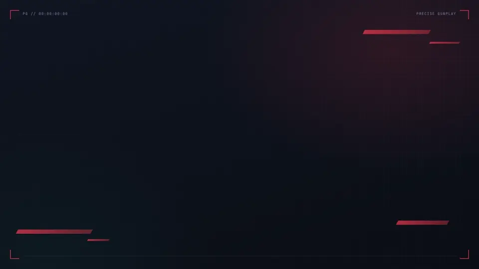

# Precise Gunplay

<a href=".github/media/presentation.mp4"></a>

<p align="center"><a href=".github/media/presentation.mp4">▶ Voir la vidéo avec le son</a></p>

## Télécharger

Va sur la page [**Releases**](https://github.com/NOUSSS/precise-gunplay/releases/latest) et prends :
- `Precise-Gunplay-Setup-x.y.z.exe` : **installeur recommandé**, qui se met à jour automatiquement ;
- `Precise-Gunplay-Portable-x.y.z.exe` : version sans installation (elle te prévient des nouvelles versions, mais la mise à jour est manuelle).

> L'app n'est pas signée numériquement : au premier lancement, Windows SmartScreen peut afficher « Windows a protégé votre ordinateur ».
> Clique sur **Informations complémentaires** puis **Exécuter quand même**.

## Résolution étirée

Onglet **Résolution étirée** : choisissez la résolution et activez l'interrupteur. Ensuite, tout est automatique :
- dès le lancement de VALORANT, avant l'ouverture de sa fenêtre, les écrans passent sur le pilote générique de Windows
  (désactivés dans le Gestionnaire de périphériques, rubrique Moniteurs), sans que l'image change ;
- 30 s après le début d'une partie (fin de l'écran de chargement), l'écran passe en résolution étirée, à la même fréquence ;
- au menu, la résolution native revient ; à la fermeture du jeu, les écrans retrouvent leur pilote.

La partie est détectée par le serveur de jeu de Riot ; s'il ne répond pas, la présence du client Riot prend le relais.
Le délai, les raccourcis (Ctrl+F8 et Ctrl+F9 par défaut) et le réglage automatique de VALORANT sont dans les réglages avancés.

Le passage sur le pilote générique demande une autorisation administrateur une seule fois (bouton **Autoriser**) : elle crée deux
tâches planifiées dans le dossier « Precise Gunplay » du Planificateur de tâches. Après une mise à jour qui change ce
script, la page propose de la renouveler. L'app ne touche jamais au processus du jeu.
Réglez aussi la mise à l'échelle de la carte graphique sur plein écran (AMD : Mise à l'échelle GPU ; NVIDIA : Plein écran, effectuée sur le GPU).

## Lancer / compiler

```bash
npm install
npm start          # lancer en développement
npm run dist       # génère l'installeur et la version portable dans dist/
```

## Publier une mise à jour

1. Change `"version"` dans `package.json` (ex : `1.0.1`) et commit.
2. Crée et pousse le tag correspondant :
   ```bash
   git tag v1.0.1
   git push origin main --tags
   ```
3. GitHub Actions compile l'app et publie la Release. Les versions installées téléchargent la mise à jour en arrière-plan
   et l'installent au prochain redémarrage.

## Avertissement

Projet non officiel, ni approuvé ni affilié à Riot Games. Il utilise les API non documentées du client.
Les fonctions qui agissent sur le compte via le Riot Client (agent auto, sélection d'agent, esquive, gestion du groupe, envoi de messages)
sont désactivées dans l'app : Riot peut les sanctionner. Elles restent visibles mais grisées (voir `src/restrictions.js`).
Les images et noms viennent de [valorant-api.com](https://valorant-api.com).
